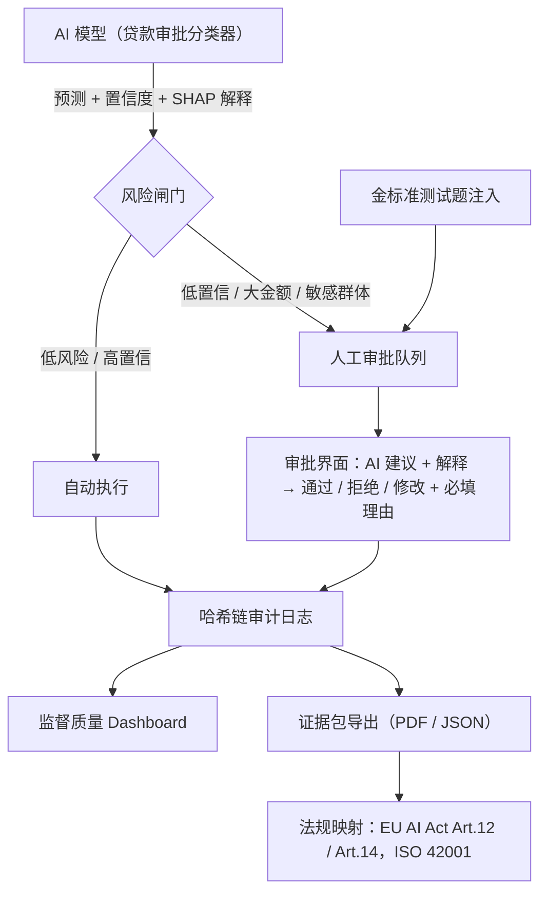

# LoopLedger — 人工审批即合规证据

> Synoptix Responsible AI Hackathon 项目方案
> 方向：**HumanLoop（AI 人工监督控制中心）+ ComplyFlow（AI 合规证据自动化）**

---

## 1. 一句话介绍

当 AI 拿不准或决策风险高时，LoopLedger 会自动把决策交给人审批。每一次审批（谁批的、看到了什么、理由是什么、花了多久）都会**自动生成防篡改、可审计的合规证据**，并对应到具体法规条款。

**Slogan：Oversight that proves itself.（会自证的人工监督）**

---

## 2. 解决的痛点

| 来源 | 痛点 |
|---|---|
| HumanLoop | 企业都说有 Human-in-the-loop，但缺少真正落地的实现机制 |
| ComplyFlow | 企业需要持续整理大量 AI 治理证据，目前多靠人手工、事后整理 |
| **结合后** | **监督机制运行的同时就产生了合规证据，不需要单独做合规工作** |

---

## 3. 核心差异化：检测"假监督"（橡皮图章）

人工监督本身也会失效。典型问题是 **automation bias（自动化偏见）**：审核员 2 秒就点"通过"，对 AI 建议的采纳率高达 99%，监督形同虚设。

LoopLedger 不只是记录"有人审过"，而是**量化监督质量，证明监督是有效的**：

| 指标 | 含义 | 预警信号 |
|---|---|---|
| 平均审阅时长 | 审核员是否认真看 | 远低于正常阅读时长 |
| Override rate（推翻 AI 比例） | 是否在独立判断 | 长期接近 0% |
| 理由质量 | 是否写了实质性理由 | 空泛、复制粘贴、过短 |
| 金标准抽检通过率 | 混入已知答案的测试题，看审核员能否发现 AI 的错误 | 漏检率高 |

> 这一点直接回应了评委的两条要求：**"how do we measure, evaluate, prove, justify trust"** 和 **"talk about humans, how they think — the user is part of the system"**。

---

## 4. 系统架构



### 模块说明

1. **被监督的 AI**：用 German Credit 数据集训练的贷款审批分类器（sklearn / XGBoost），用 SHAP 给出每个决策的关键特征。刻意选用传统 ML，呼应评委说的 "consider technologies beyond LLMs"。
2. **风险闸门**：按规则把决策路由到人工队列，例如置信度 < 0.7、贷款金额超过阈值、涉及受保护属性的边缘案例。
3. **审批界面**：显示申请信息、AI 建议、置信度和 SHAP 解释。审核员必须选择操作并填写理由，系统自动记录审阅时长。
4. **哈希链审计日志**：每条记录包含上一条记录的 hash，任何篡改都会让链条断裂、被系统检测到。
5. **监督质量 Dashboard**：实时展示第 3 节的各项指标，异常时亮红色警告。
6. **证据包导出**：一键生成审计报告，把日志和指标自动对应到相应法规条款。

---

## 5. 法规映射

| 法规条款 | 要求 | LoopLedger 提供的证据 |
|---|---|---|
| EU AI Act Art.12 | 高风险系统需自动记录日志 | 哈希链审计日志，记录全部决策 |
| EU AI Act Art.14 | 有效的人工监督，监督者应能意识到 automation bias | 人工审批记录 + 监督质量指标 + 橡皮图章预警 |
| EU AI Act Art.13 | 对使用者透明 | 每个决策附带 SHAP 解释 |
| ISO/IEC 42001 | AI 管理体系，可追溯 | 可导出的证据包 |

---

## 6. 展台 Demo 剧本（约 3 分钟）

1. **批量运行**：提交 50 个贷款申请，其中 40 个自动通过，10 个进入人工队列。
2. **评委参与**：请评委亲自当审核员，审批几条申请，体验 AI 建议加解释的界面。
3. **橡皮图章演示**：队员连续秒批，Dashboard 立即亮红色预警。混入的金标准错误题被漏掉，系统会把它指出来。
4. **导出证据包**：一键生成按法规条款整理好的审计报告。
5. **篡改检测**：手动修改数据库里的一条日志，系统检测到哈希链断裂，显示 **"Tampered"**。

---

## 7. 外部因素（Funding / Politics / Scaling / Adoption）

- **政策驱动**：EU AI Act 高风险系统义务从 2026 年 8 月起生效，第 14 条明确要求"有效的"人工监督，企业有现实的合规需求。
- **商业模式**：面向银行、保险、HR、公共部门等高风险 AI 使用方，按审批量或席位收费的 SaaS。
- **低接入成本**：提供 SDK，一行装饰器就能接入现有模型：
  ```python
  @require_oversight(risk="high", reason_required=True)
  def approve_loan(application): ...
  ```
- **可扩展**：被监督对象可以从分类器扩展到 LLM Agent（如发邮件、导出数据等操作）。

---

## 8. 技术栈与分工

| 模块 | 技术 | 负责人 |
|---|---|---|
| 被监督的 AI | scikit-learn / XGBoost + SHAP，German Credit 数据集 | ML 同学 |
| 后端 + 哈希链日志 | FastAPI + SQLite | 后端 |
| 审批界面 + Dashboard | Streamlit（最快）或 React | 前端 |
| 证据包导出 + 法规映射 | Jinja2 模板 → Markdown / PDF | 1 人，兼做 pitch |

---

## 9. 时间线

| 时间 | 任务 |
|---|---|
| Day 1 11:30–13:00 | 训练模型、实现风险闸门、设计数据库表 |
| Day 1 13:00–15:30 | 审批界面、哈希链日志 |
| Day 1 15:30–17:00 | 监督质量指标、金标准抽检 |
| Day 2 09:00–11:00 | 证据包导出、篡改检测演示、彩排 |
| Day 2 12:00–14:00 | 展台展示（桌前至少保持 2 人） |

---

## 10. 对照评委要求自查

| 评委要求 | LoopLedger 的回答 |
|---|---|
| 衡量 / 证明可信度 | 监督质量指标 + 金标准抽检 + 哈希链防篡改 |
| 简单的想法，执行到位 | 核心只有一句话："人工审批即合规证据" |
| 不只是 LLM | 被监督对象是传统分类器 |
| 人是系统的一部分 | 显式建模并检测人的 automation bias |
| 外部因素 | EU AI Act 生效时间点、SaaS 模式、一行接入 |
